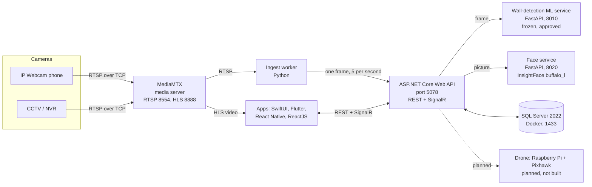
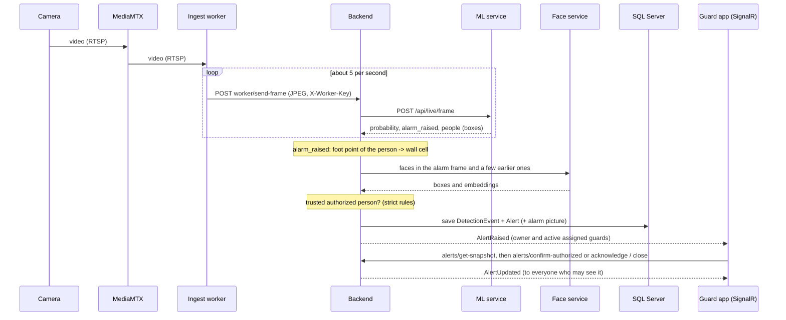

# Architecture

AeroSentry watches the walls of a property. Fixed cameras feed a wall-crossing detection model; when a person climbs, the system works out **which cell of the wall** they are in, raises an **alert** to the owner and the guards, and (later) sends a **drone** to that spot. Enrolled people (residents, employees, visitors) are recognised by face so they do not trigger the automatic response. Everything runs on a local network with **no internet** at runtime.

This backend is the single hub: apps talk only to it, and only it talks to the ML services, the database and (later) the drone.

## The parts

| Part | Technology | Port | Folder | Stateless? | Notes |
|---|---|---|---|---|---|
| Backend API | ASP.NET Core (.NET 11), EF Core | 5078 | `AeroSentry.Api/` | yes (state is in SQL Server, plus in-memory ML session map) | REST under `/api/v1`, SignalR hub at `/hubs/alerts`, Scalar page at `/scalar` (Development) |
| Database | SQL Server 2022 in Docker | 1433 | (Docker) | no | `docs/DATABASE.md` |
| Wall-detection ML | Python, YOLO11n-pose + BiLSTM | 8010 | outside the repo (`FINAL FYP AI MODEL/`) | no (sessions in memory) | Frozen and approved: never modified. A CPU copy exists next to it |
| Face service | Python, InsightFace `buffalo_l` | 8020 | `face-service/` | yes | Detects faces and returns embeddings only |
| Ingest worker | Python, OpenCV | none (a client) | `ingest-worker/` | yes | Reads camera streams, posts frames |
| Media server | MediaMTX (one executable) | 8554, 8888 | `media/` | no | One connection to each camera, many readers |
| Drone | Raspberry Pi + Pixhawk | | separate repo | | **Not built.** `docs/FUTURE-WORK.md` |

## Layers inside the backend
Client -> **Controller** (token, status codes) -> **Service** (every rule) -> **`AppDbContext`** (EF Core) -> **SQL Server**.
Entities are the tables, DTOs are the only things that cross the API. Services that call other programs go through one client class each: `MlClient`, `FaceClient`, `CameraSnapshotClient`. Details and the common patterns (`Result<T>`, `PropertyAccess`): `docs/HOW-IT-WORKS.md`.

## The main path: from a camera to a guard's phone

## Security model
- **Who you are:** login returns a JWT (`sub`, `email`, `role`, `exp`), signed with `Jwt:Key`. On every request the signature, issuer, audience and expiry are checked, and the database is asked whether the user is still active (a suspended user is refused at once).
- **Roles:** `Admin` (self-registered, owns properties) and `Guard` (created by an admin, read-mostly). The role comes from the server, never from the client.
- **Ownership:** the caller's id comes from the token and is applied to every query (`PropertyAccess`). Another admin's data answers **404**, never 403, so ids cannot be probed.
- **Machines:** the ingest worker has no login; it proves itself with the header `X-Worker-Key` (constant-time comparison). A user token does not open `worker/*`, and the key opens nothing else.
- **Real time:** the SignalR hub needs a token (header, or `?access_token=` for browsers). Recipients are worked out at the moment of the alarm; a suspended or deleted guard's open connection is closed; connections close when the token expires.
- **Secrets:** database password, JWT key and worker key live in `appsettings.Local.json` (git-ignored). A missing or placeholder secret stops the backend at startup. No secret was ever committed (checked on every branch).
- **Sensitive data:** faces (enrolment photos, face vectors) and alarm pictures are readable only through admin functions (alarm pictures also by the property's guards), and removing a person deletes their face data. **Not done:** encryption at rest (camera passwords, face data, pictures), liveness checks, retention limits.
- **CORS:** only the origins in `Cors:Origins` may call the API from a browser.

## Decisions that shape the design
| Decision | Why |
|---|---|
| The backend is the only caller of the ML services | Apps stay simple, one place enforces access, the frozen ML model is never exposed |
| The face service is separate and only returns embeddings | The people, photos and matching rules live with the rest of the data, in one database |
| An alert is **never** suppressed by a face match; it only skips the automatic response, and a guard confirms | A false match silently hiding a real intruder costs far more than one extra alert |
| The ingest worker is a separate program, not part of the ML service | The approved model stays untouched; the worker handles streams and frame rate |
| Frames are chosen by **time** (about 5 per second) | The model was trained on one frame in 5 of mostly 25 fps video; any camera then looks the same to it |
| "Being watched" is stored in the database | A backend restart must not silently stop protection |
| Function-named endpoints (`/api/v1/<feature>/<action>`) | Teammates can tell what a function does from its name |
| One media server in the middle | A camera allows few connections; browsers cannot play RTSP; the camera's login stays out of the apps |
| Two copies of the ML service (GPU original, CPU copy) | The CPU version is about 6 times faster on this Mac with identical answers; the approved original is untouched |

## Running on one machine (the demo)
Everything runs on one Mac on the local network: SQL Server (Docker), MediaMTX, the ML service, the face service, the backend and the worker. The core API needs only SQL Server and the backend; the rest are optional extras. Start order and commands: `docs/OFFLINE-CHECKLIST.md`.

## Limits worth knowing
- Faces at a wall camera are usually too small to recognise (13 to 50 px wide on the dataset's wall footage), so the "authorized person" feature mostly helps on cameras that see faces large.
- The ML service analyses about 2 frames/s on the GPU and about 14 on the CPU (this Mac); several walls at once has not been measured.
- The drone feature is not built; the real CCTV cameras and the NVR are untested.
- Everything else not done is listed in `docs/FUTURE-WORK.md`.
