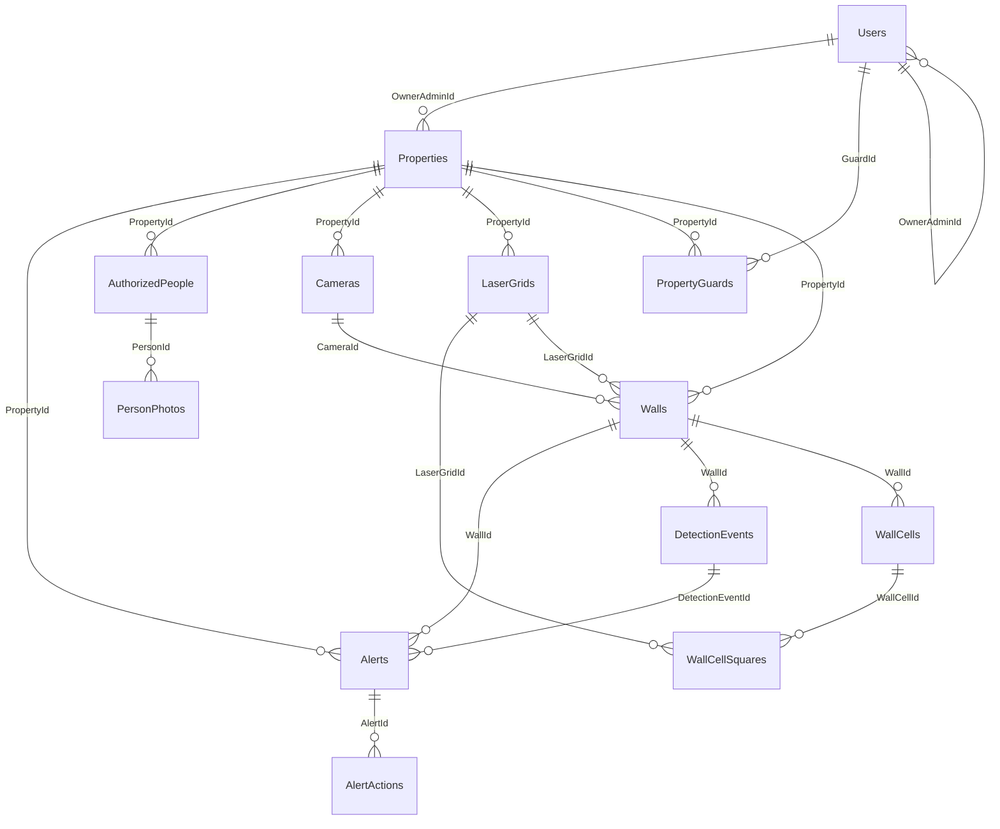

# Database reference

SQL Server 2022 (Docker), accessed with EF Core. This page was **generated from the live database** after all 14 migrations were applied, so it matches the real schema. The C# side is `AeroSentry.Api/Data/Entities/` and `Data/AppDbContext.cs`; the history of changes is `AeroSentry.Api/Migrations/`.

- Ids are `uniqueidentifier` (Guid) unless noted; times are UTC.
- Text columns are `nvarchar(n)` (n characters); `max` means no limit.
- Delete rules: **Cascade** = deleting the parent row deletes these rows too; **Restrict** (shown as NO_ACTION) = the database refuses to delete a parent that still has these rows.
- Two tables hold biometric data (`AuthorizedPeople`, `PersonPhotos`) and `DetectionEvents` holds alarm pictures that can show faces: only admins (and, for alarm pictures, the property's guards) can read them through the API.

## Relationships

Every table below the property hangs from `Properties`, so deleting a property deletes cameras, grids, walls, cells, routes, detection events, alerts, alert history and authorized people with it.

## Tables

### Users

Everyone who can sign in: admins and the guards an admin creates (`OwnerAdminId`). Role, active flag, password hash.

| Column | Type | Null | |
|---|---|---|---|
| `Id` | uniqueidentifier | no |  |
| `FullName` | nvarchar(max) | no |  |
| `Email` | nvarchar(256) | no |  |
| `PasswordHash` | nvarchar(max) | no |  |
| `Role` | nvarchar(max) | no |  |
| `IsActive` | bit | no |  |
| `CreatedAtUtc` | datetime2 | no |  |
| `PhoneNumber` | nvarchar(max) | no |  |
| `OwnerAdminId` | uniqueidentifier | yes |  |

Rules:
- Primary key: (Id)
- Unique: (Email)
- Index: (OwnerAdminId)
- `OwnerAdminId` -> `Users.Id`, on delete **Restrict**

### Properties

A place being protected. Owned by one admin.

| Column | Type | Null | |
|---|---|---|---|
| `Id` | uniqueidentifier | no |  |
| `OwnerAdminId` | uniqueidentifier | no |  |
| `Name` | nvarchar(200) | no |  |
| `Address` | nvarchar(300) | no |  |
| `Latitude` | float | yes |  |
| `Longitude` | float | yes |  |
| `CreatedAtUtc` | datetime2 | no |  |
| `Note` | nvarchar(500) | yes |  |

Rules:
- Primary key: (Id)
- Index: (OwnerAdminId)
- `OwnerAdminId` -> `Users.Id`, on delete **Restrict**

### PropertyGuards

Join table: which guards work at which property.

| Column | Type | Null | |
|---|---|---|---|
| `PropertyId` | uniqueidentifier | no |  |
| `GuardId` | uniqueidentifier | no |  |
| `AssignedAtUtc` | datetime2 | no |  |

Rules:
- Primary key: (PropertyId, GuardId)
- Index: (GuardId)
- `GuardId` -> `Users.Id`, on delete **Cascade**
- `PropertyId` -> `Properties.Id`, on delete **Cascade**

### Cameras

A camera of a property: IP Webcam phone, CCTV or NVR channel. Holds its address and (plain) login.

| Column | Type | Null | |
|---|---|---|---|
| `Id` | uniqueidentifier | no |  |
| `PropertyId` | uniqueidentifier | no |  |
| `Name` | nvarchar(200) | no |  |
| `SourceType` | nvarchar(20) | no |  |
| `Host` | nvarchar(255) | no |  |
| `Port` | int | no |  |
| `StreamPath` | nvarchar(300) | no |  |
| `Username` | nvarchar(100) | yes |  |
| `Password` | nvarchar(200) | yes |  |
| `IsActive` | bit | no |  |
| `CreatedAtUtc` | datetime2 | no |  |

Rules:
- Primary key: (Id)
- Unique: (PropertyId, Name)
- `PropertyId` -> `Properties.Id`, on delete **Cascade**

### LaserGrids

An installed laser grid: rows x columns of squares of a chosen size.

| Column | Type | Null | |
|---|---|---|---|
| `Id` | uniqueidentifier | no |  |
| `PropertyId` | uniqueidentifier | no |  |
| `Name` | nvarchar(200) | no |  |
| `Rows` | int | no |  |
| `Columns` | int | no |  |
| `SquareSizeMeters` | float | no |  |
| `CreatedAtUtc` | datetime2 | no |  |

Rules:
- Primary key: (Id)
- Unique: (PropertyId, Name)
- `PropertyId` -> `Properties.Id`, on delete **Cascade**

### Walls

One camera view of one wall: the camera, the wall annotation (two lines), the laser grid and camera position, and whether it is being watched.

| Column | Type | Null | |
|---|---|---|---|
| `Id` | uniqueidentifier | no |  |
| `PropertyId` | uniqueidentifier | no |  |
| `Name` | nvarchar(200) | no |  |
| `CameraId` | uniqueidentifier | no |  |
| `FrameWidth` | int | no |  |
| `FrameHeight` | int | no |  |
| `TopPointsJson` | nvarchar(max) | no |  |
| `BottomPointsJson` | nvarchar(max) | no |  |
| `LaserGridId` | uniqueidentifier | yes |  |
| `CameraGridRow` | int | yes |  |
| `CameraGridCol` | int | yes |  |
| `CreatedAtUtc` | datetime2 | no |  |
| `DetectionEnabled` | bit | no |  |
| `DetectionThreshold` | float | yes |  |

Rules:
- Primary key: (Id)
- Index: (CameraId)
- Index: (LaserGridId)
- Unique: (PropertyId, Name)
- `CameraId` -> `Cameras.Id`, on delete **Restrict**
- `LaserGridId` -> `LaserGrids.Id`, on delete **Restrict**
- `PropertyId` -> `Properties.Id`, on delete **Cascade**

### WallCells

A marked area of a wall (A1, A2, ...): 4 corners and a real length.

| Column | Type | Null | |
|---|---|---|---|
| `Id` | uniqueidentifier | no |  |
| `WallId` | uniqueidentifier | no |  |
| `Label` | nvarchar(50) | no |  |
| `Position` | int | no |  |
| `LengthMeters` | float | no |  |
| `CornersJson` | nvarchar(max) | no |  |

Rules:
- Primary key: (Id)
- Unique: (WallId, Label)
- `WallId` -> `Walls.Id`, on delete **Cascade**

### WallCellSquares

The laser route of a cell: the grid squares the drone visits, in order. A square belongs to one cell only.

| Column | Type | Null | |
|---|---|---|---|
| `Id` | uniqueidentifier | no |  |
| `WallCellId` | uniqueidentifier | no |  |
| `LaserGridId` | uniqueidentifier | no |  |
| `Order` | int | no |  |
| `Row` | int | no |  |
| `Col` | int | no |  |

Rules:
- Primary key: (Id)
- Unique: (LaserGridId, Row, Col)
- Unique: (WallCellId, Order)
- `LaserGridId` -> `LaserGrids.Id`, on delete **Restrict**
- `WallCellId` -> `WallCells.Id`, on delete **Cascade**

### DetectionEvents

One alarm raised by the wall model for a wall, with the cell, probability and the alarm picture.

| Column | Type | Null | |
|---|---|---|---|
| `Id` | uniqueidentifier | no |  |
| `WallId` | uniqueidentifier | no |  |
| `CellId` | uniqueidentifier | yes |  |
| `CellLabel` | nvarchar(50) | yes |  |
| `Probability` | float | no |  |
| `Threshold` | float | no |  |
| `FrameNumber` | int | no |  |
| `TimestampSeconds` | float | no |  |
| `MlSessionId` | nvarchar(50) | no |  |
| `DetectedAtUtc` | datetime2 | no |  |
| `AlarmSnapshot` | varbinary(max) | yes |  |

Rules:
- Primary key: (Id)
- Index: (WallId, DetectedAtUtc)
- `WallId` -> `Walls.Id`, on delete **Cascade**

### Alerts

One incident shown to the owner and guards, created from a detection event. Numbered INC-0001...

| Column | Type | Null | |
|---|---|---|---|
| `Id` | uniqueidentifier | no |  |
| `Number` | int | no | identity |
| `DetectionEventId` | uniqueidentifier | no |  |
| `PropertyId` | uniqueidentifier | no |  |
| `WallId` | uniqueidentifier | no |  |
| `CellId` | uniqueidentifier | yes |  |
| `CellLabel` | nvarchar(50) | yes |  |
| `Probability` | float | no |  |
| `Status` | nvarchar(20) | no |  |
| `CreatedAtUtc` | datetime2 | no |  |
| `RecognitionScore` | float | yes |  |
| `RecognizedPersonCategory` | nvarchar(20) | yes |  |
| `RecognizedPersonId` | uniqueidentifier | yes |  |
| `RecognizedPersonName` | nvarchar(100) | yes |  |
| `AutoResponseSkipped` | bit | no |  |

Rules:
- Primary key: (Id)
- Unique: (DetectionEventId)
- Unique: (Number)
- Index: (PropertyId, CreatedAtUtc)
- Index: (WallId)
- `DetectionEventId` -> `DetectionEvents.Id`, on delete **Cascade**
- `PropertyId` -> `Properties.Id`, on delete **Restrict**
- `WallId` -> `Walls.Id`, on delete **Restrict**

### AlertActions

The history of an alert: who acknowledged, closed, escalated or confirmed it, and when.

| Column | Type | Null | |
|---|---|---|---|
| `Id` | uniqueidentifier | no |  |
| `AlertId` | uniqueidentifier | no |  |
| `Action` | nvarchar(30) | no |  |
| `FromStatus` | nvarchar(20) | no |  |
| `ToStatus` | nvarchar(20) | no |  |
| `ByUserId` | uniqueidentifier | no |  |
| `ByName` | nvarchar(100) | no |  |
| `ByRole` | nvarchar(20) | no |  |
| `Note` | nvarchar(500) | yes |  |
| `AtUtc` | datetime2 | no |  |

Rules:
- Primary key: (Id)
- Index: (AlertId, AtUtc)
- `AlertId` -> `Alerts.Id`, on delete **Cascade**

### AuthorizedPeople

A whitelisted person (resident, employee, visitor) with the average face vector. Biometric data.

| Column | Type | Null | |
|---|---|---|---|
| `Id` | uniqueidentifier | no |  |
| `PropertyId` | uniqueidentifier | no |  |
| `Name` | nvarchar(100) | no |  |
| `Phone` | nvarchar(30) | yes |  |
| `Category` | nvarchar(20) | no |  |
| `ValidUntil` | date | yes |  |
| `AccessDisabled` | bit | no |  |
| `Note` | nvarchar(500) | yes |  |
| `EnrolledAtUtc` | datetime2 | no |  |
| `MeanEmbedding` | varbinary(max) | no |  |

Rules:
- Primary key: (Id)
- Index: (PropertyId)
- `PropertyId` -> `Properties.Id`, on delete **Cascade**

### PersonPhotos

The three enrolment photos (front, left, right) of a person and each photo's face vector. Biometric data.

| Column | Type | Null | |
|---|---|---|---|
| `Id` | uniqueidentifier | no |  |
| `PersonId` | uniqueidentifier | no |  |
| `Angle` | nvarchar(10) | no |  |
| `ContentType` | nvarchar(50) | no |  |
| `Image` | varbinary(max) | no |  |
| `Embedding` | varbinary(max) | no |  |
| `FaceWidth` | int | no |  |

Rules:
- Primary key: (Id)
- Unique: (PersonId, Angle)
- `PersonId` -> `AuthorizedPeople.Id`, on delete **Cascade**
